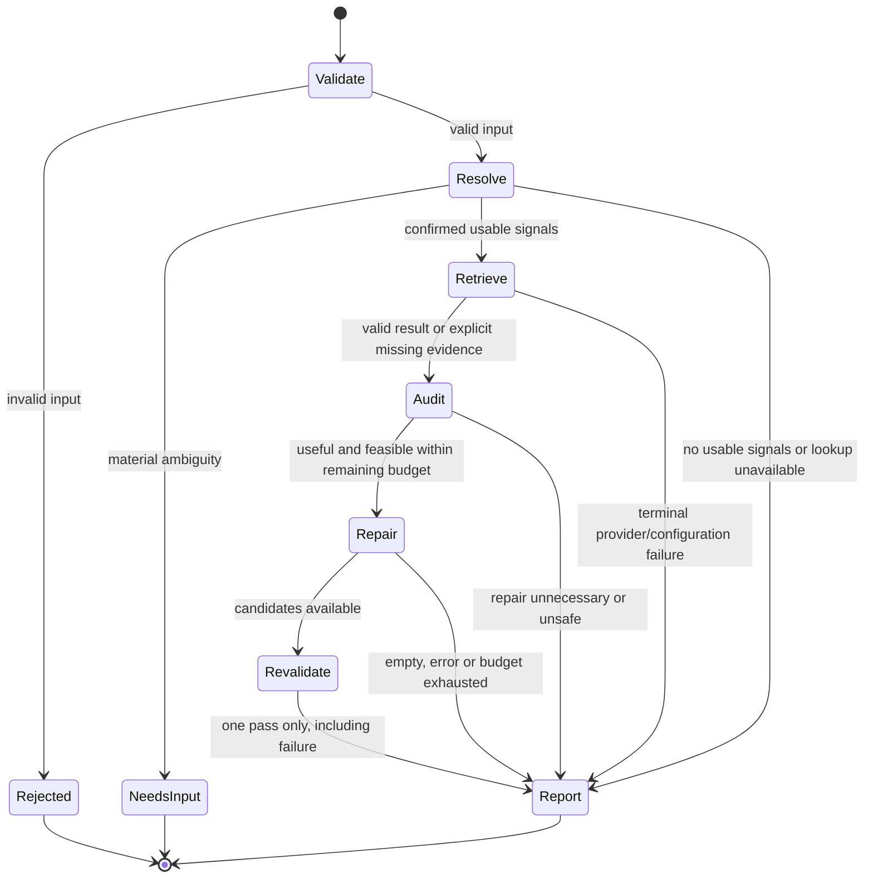

# Bounded audit state machine

**Phase 0 specification — not an implemented agent.** Product states below are distinct from Agentic Intent Gate Run/Action states. See [architecture](ARCHITECTURE.md) for contracts and [Qloo contract](QLOO_API_CONTRACT.md) for provider evidence.

## Read-only flow

`NeedsInput` returns structured choices and consumes no further provider/model calls. A user reply starts a fresh read-only run with explicit reviewed selections; do not mutate a completed report. User-requested partial use of fewer preferences must be explicit, retain the omitted preference and prevent an unqualified complete PASS. No infinite clarification loop or autonomous reinterpretation.

| State | Allowed work | Exit requirements | Failure behavior |
| --- | --- | --- | --- |
| Validate | Strict parse, bounded fields, deduplicate checks | Valid consumer input; no authority fields accepted | Rejected; no Qloo calls |
| Resolve | Fixed entity/tag lookups; optional LLM interpretation proposal | Traceable selected identities, confirmed preference meanings | Ambiguous → NeedsInput; empty → unresolved; auth/config fault → report |
| Retrieve | Original-set place Insights; optional separately enabled explanation | Validated raw-to-internal projection; exact query context | Empty/missing → explicit unknown; malformed → schema mismatch |
| Audit | Pure constraint/evidence/claim checks | Finding per original and each relevant constraint | LLM inference alone cannot yield factual fail or provider-backed pass |
| Repair | At most one discovery; optional selection from returned IDs | Bounded candidate list, no duplicate/excluded IDs | No candidate → retain original finding; no fallback fabricated candidate |
| Revalidate | Up to three identity confirmations and one common-set ranking; same deterministic rules | Every selected replacement has its own validated audit | Failed/unknown replacement not accepted; no second repair cycle |
| Report | Validate all references, derive modes, compute before/final summaries | Original findings retained, missing slots visible, usage accurate | Integrity mismatch → BLOCKED; valid partial report may still be returned |

Every state checks cancellation and remaining deadline before work. Auth/permission/profile failure ends further network work; missing evidence can still be audited locally. TIMEOUT/429 stops additional live dispatches for this run. No state can execute archive, booking, email, payment or model-selected code.

## Explicit dispatch budget

Trusted server cap **14 Qloo HTTP dispatches**, zero automatic retries; this is an initial consumer policy, not an official rate limit. Proposed allocation for the one NYC case:

| Operation | Maximum dispatches | Notes |
| --- | ---: | --- |
| Preference resolution | 4 | One artist, one confirmed film, up to two tag concept searches |
| Destination clarification/lookup | 1 | Optional; omit if a reviewed exact city tuple suffices |
| Original place resolution | 3 | At most three originals |
| Original shortlist Insights | 1 | No geography prefilter that hides violations |
| Candidate discovery | 1 | One query, take <=5 |
| Replacement identity/metadata confirmation | 3 | Up to three selected places; search match must equal the discovered ID; no assumed by-ID API |
| Common-set ranking/revalidation | 1 | Eligible originals plus up to three replacements, maximum six IDs |
| **Total** | **14** | Any search/tag pagination or optional extra feature probe uses unspent slots, never increases the cap |

Reserve the revalidation allocation before starting repair. Skip repair if it cannot fit; do not show an unvalidated replacement as accepted. If explainability needs another network request, it uses the same cap. Cache hits are reported but are not network dispatches. Failed attempts consume a slot. Parallel requests cannot oversubscribe the budget; initial Qloo concurrency is one. No hidden harness calls are permitted under this REST profile.

Maximum two LLM dispatches: (1) optional interpretation/claim extraction, (2) optional selection and evidence-bounded explanation. No iterative planning retries. Invalid model output causes a local fallback to deterministic templated findings or an explicit MODEL_OUTPUT_INVALID limitation, never relaxed schema acceptance. Synthetic offline case needs zero LLM calls.

Overall read-only envelope: 60 seconds; Qloo call timeout <=4 seconds, LLM call timeout <=5 seconds, each clamped to the remaining monotonic budget. The cap is a ceiling, not a promise to complete 14 slow calls plus local work. On expiry, cancel I/O, discard late results, perform no more calls and assemble only a valid partial report. Measured latency/cost are NOT RUN.

## Decision state and workflow state are separate

`Report` is a terminal workflow state; its result can be PASS, REVIEW, REPAIR_SUGGESTED, BLOCKED or UNKNOWN. Finishing an HTTP request does not prove successful verification. A Qloo 200 result does not imply passed constraints. A final UNKNOWN may include a proven hard failure in the retained original audit and an independently validated replacement elsewhere.

Track `before_status` across originals and `final_status` across the selected final set plus unrepaired/missing slots. Priority: integrity/unrepaired hard failure → BLOCKED; essential uncertainty → UNKNOWN; soft evidence/claim issues → REVIEW or REPAIR_SUGGESTED; otherwise PASS. `completion=partial` prevents empty or selectively omitted evidence from appearing as a complete success.

## Optional archive flow — delegated to existing Runtime

The read-only audit completes before any archive proposal. The following is a mapping of required behavior, not a second implementation of the core's state machine:

| Event | Required control |
| --- | --- |
| Human chooses to archive an exact immutable report | Server creates a one-step consumer Plan through the installed Runtime |
| Plan is presented and approved | Existing persistent Run/exact approval binding; UI shows report hash and scope |
| Action is admitted | Supported Runtime admission path with current versions and verified principal |
| Execution is authorized separately | Independent Runtime authorization policy; approval alone cannot dispatch |
| Execute command | Existing Gateway durable claim, CAS and single-owner fencing |
| Local effect and verified receipt | Consumer validates identity/arguments, transactionally writes report+receipt, verifies readback |
| Lost acknowledgment/late result/restart | Existing terminal Unknown/recovery behavior, no retry or second effect |

No model, browser flag or Qloo response selects grant decisions, binding identities or budgets. An audit run ID is not a Runtime approval or authorization. Mapping a report to a Plan must retain both identities; editing the report invalidates that proposed digest and requires a new approval path. A product UNKNOWN finding and a Runtime `Unknown` effect outcome describe different things and must be labeled separately.

## Planned focused tests (NOT RUN)

- Every allowed transition and prohibited second repair round; ambiguous resolution stops subsequent calls.
- Dispatches 14/15, unspent-slot pagination, repair-reserve exhaustion and shared timeout; no requests after cancellation/429/auth failure.
- Fixture/live separation, no missing-key success fallback, stale cache timestamps, dangling/cross-run references, LLM-fabricated IDs.
- Hard fail versus unknown geography; original wrong-city result is not filtered out before audit; replacement passes the same checks.
- Common-set query context for relative ranking; no comparisons of incompatible normalized scores.
- Runtime archive success/persistence, stale approval, absent authorization, wrong identity, duplicate/conflict/concurrency, lost acknowledgment and actual restart without a second effect.

These are acceptance designs. No transition dispatcher, provider client or Runtime consumer was implemented in Phase 0.
