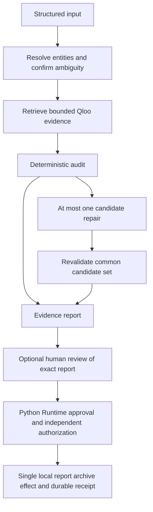

# Minimal architecture and contracts

**Phase 0 design, 2026-10-16. NOT IMPLEMENTED.** Inputs, names and budgets below are consumer proposals (ASSUMED), not Qloo or Runtime API additions. See [API findings](QLOO_API_CONTRACT.md) and [sources](PHASE0_SOURCES.md).

## ADR-01 — One product flow, explicit evidence

Use Next.js, React and TypeScript for a future server-rendered product; Zod for closed internal input/output validation, Vitest for deterministic/adapter tests, and Playwright only when a UI exists. One server-owned finite state machine coordinates a fixed read-only sequence. It is not a reusable execution framework, dynamic tool router, multi-agent engine or replacement for the shared Runtime. An optional configurable LLM proposes interpretations, claim extractions or selections; deterministic rules and provider evidence control conclusions.



No Qloo/MCP/model credentials go to the browser. Original recommendations and provider descriptions are untrusted data, not system instructions. The public response uses a reviewed data projection rather than returning raw provider JSON.

## ADR-02 — Reuse the Runtime within its supported scope

Root AGENTS.md requires the pinned Python Agentic Intent Gate; the strategy's TypeScript loop must not be interpreted as permission to recreate its durable execution controls. S19/S20 support one registered SIDE_EFFECT action and do not support arbitrary READ_ONLY/multi-tool execution. The audit loop stays product-owned. **Proposed integration seam for human review:** archive one immutable completed report locally. Qloo retrieval is not mislabeled as a Runtime effect.

| Boundary | Owner | Authority |
| --- | --- | --- |
| Read-only Qloo operations | TasteGate server adapter | Fixed HTTPS origin, fields, count and deadline budget; no arbitrary URLs |
| LLM requests | Configured server provider | Minimized data, maximum two calls, bounded output; no secret/tool/grant control |
| Schema, identity, constraints and evidence graph | Deterministic product code | Reject invented IDs, dangling evidence and unsupported verified claims |
| One approved archive write | Installed Python Runtime + consumer executor | Existing approval, admission, independent authorization, claim, fencing and receipts |
| Runtime core source | External pinned dependency | No copy, modification, monkeypatch or private API imports |

The archive tool is a **new product responsibility proposed for review**, not a pre-existing feature or automatic phase authorization. If the reviewer finds it unnecessary, resolve Runtime scope before implementation rather than add a ceremonial dependency or bypass AGENTS.md.

Initial proposed identity: tool `archive_audit_report`, version `1`, target `tastegate-report-archive`, adapter `tastegate-local-archive`, base binding revision `archive-v1`. Generate a UUIDv4 execution scope once during explicit private provisioning; retain it with the store identity across restarts. These names are internal design choices, not public Qloo names. Omit the timeout argument and keep the **five-second Runtime default**. No extended profile is required for a small local write.

Only three flat required scalar arguments cross the Runtime action boundary: `report_id` (bounded UUID string), `report_sha256` (64 lowercase hex characters), `schema_revision` (bounded exact reviewed revision). They fit the core's bounded flat schema. Do not pass the report's nested arrays through `ToolCapability` or let the model choose paths, bindings, stores, scope, timeout or grants. The executor loads the pre-reviewed immutable payload by ID from a private staging store, rehashes it, validates its revision and caller ownership, then atomically archives exactly those bytes and a correlated durable receipt in a consumer-owned store. A digest alone is not permission to load any user's report.

Lifecycle: prepare report → deterministic one-step proposal via a suitable consumer `ModelProvider` → persistent Run → exact human Plan approval displaying report/digest and local-write scope → admission → **separate execution authorization** → durable claim → executor validates identity/content → transaction commits report + receipt → independently read back/digest-check within budget → correlated outcome → Runtime durable completion. Report edits require a new digest/Run/approval/authorization. Scripted example consent is never production human consent. A preexisting grant does not authorize a new report.

No custom approval engine, action retry queue or reconciliation is added. Lost acknowledgment, late receipt or uncertain commit is terminal Runtime `Unknown`; no second write is attempted automatically. Preserve the private gate and consumer store for audit. No report is published, emailed, booked or purchased by the tool.

## Runtime verification boundary

Live public Git refs match the required annotated tag and peeled SHA. Source/example inspection confirms these source signatures (S19/S22):

```python
# Source-level reference only; not an installed-package test or runnable consumer.
ToolCapability(binding, description, input_schema,
               target_argument=None, semantic_rule=None)
open_runtime(*, gate_path, provider, capability, registry, verifier, policy,
             predecessor_stopped=False, execution_timeout_seconds=5)
```

There is no current consumer Python project/lock/environment and the current interpreter reports no installed distribution. **Installed version, provenance, imports and signatures are NOT RUN.** Before any integration code: introduce Python 3.13 project metadata, merge the exact dependency below, lock it, install into the consumer environment, verify `importlib.metadata` version/direct URL commit and `inspect.signature` on the actual public imports. Confirm import path is installed site-packages, not an adjacent checkout; verify lockfile and installed provenance agree. Read S19/S20/S21 again if an API change is proposed.

```toml
# Planned entry only. No pyproject.toml was created in Phase 0.
"agentic-intent-gate @ git+https://github.com/miku-wwl/agentic-intent-gate.git@7261fdd2f47d2b15fabe8faac527eeee37338eb1"
```

Core verification acceptance includes success and persistent readback; wrong tool/target/binding/scope, absent authorization, stale approval, duplicate/concurrent/conflicting effects and lost acknowledgment/restart without a second effect. No claim of satisfying this chain is made by Phase 0.

## Proposed internal input/output contracts

These are **design declarations**, not compiled TypeScript or a provider wire schema. IDs below are consumer IDs unless explicitly Qloo IDs. Nullable fields mean unknown; omission must never be interpreted as a successful check.

```typescript
type Mode = "fixture" | "live" | "mixed";
type Verdict = "PASS" | "REVIEW" | "REPAIR_SUGGESTED" | "BLOCKED" | "UNKNOWN";
type CheckState = "pass" | "fail" | "unknown" | "not_applicable";
type FindingClass = "hard_constraint" | "insufficient_evidence"
  | "relative_relevance" | "uncertainty" | "integrity";
type Constraint =
  | { id: string; kind: "city" | "country"; value: string }
  | { id: string; kind: "entity_type"; value: "place" }
  | { id: string; kind: "max_items"; value: number };
interface AuditInput {
  schema_revision: "tastegate.input.v0";
  preferences: Array<{
    id: string; text: string; kind: "artist" | "film_concept" | "tag_concept";
    confirmed_anchor: string | null;
  }>;
  task: string;
  destination: string;
  constraints: Constraint[];
  recommendations: Array<{ id: string; name: string;
    address_hint: string | null; claims: string[] }>;
}
interface Provenance {
  evidence_id: string;
  source_mode: "fixture" | "live";
  provider: "synthetic" | "qloo" | "user";
  operation: "input" | "entity_lookup" | "tag_lookup" | "insights";
  call_id: string | null;                 // Local correlation, not a provider ID.
  upstream_request_id: string | null;     // Only if actually supplied/verified.
  retrieved_at: string | null;            // Real fetch time; null for design fixture.
  query_fingerprint: string | null;
  pointer: string;                        // Path inside private snapshot/fixture.
  entity_ids: string[];
  cache_hit: boolean;
  fetched_at: string | null;              // Original fetch time for cached data.
  warnings: string[];
}
interface Finding {
  code: string; category: FindingClass;
  state: CheckState; evidence_refs: string[];
  explanation: string;                    // Consumer interpretation, attributed.
}
interface CandidateAudit {
  candidate_id: string;
  resolution: "resolved" | "ambiguous" | "unresolved";
  entity_id: string | null;
  hard_constraints: CheckState;
  evidence_coverage: "covered" | "partial" | "missing";
  cultural_relevance: { query_ref: string; ordinal_rank: number } | null;
  explainability: "available" | "missing" | "not_requested";
  verdict: Verdict;
  findings: Finding[];
}
interface Repair {
  replaces: string; replacement_candidate_id: string;
  discovery_evidence_refs: string[];
  revalidation: CandidateAudit;
  accepted: boolean;
}
interface AuditReport {
  schema_revision: "tastegate.report.v0";
  run_id: string; source_mode: Mode;
  input_ref: string;
  before_status: Verdict; final_status: Verdict;
  completion: "complete" | "partial";
  original_audits: CandidateAudit[];
  repairs: Repair[];
  final_candidate_ids: string[];
  evidence: Provenance[];
  unresolved_preferences: string[];
  limitations: string[];
  usage: { qloo_dispatches: number; llm_dispatches: number;
    elapsed_ms: number | null };
  archive: { status: "not_requested" | "awaiting_approval" | "succeeded"
    | "unknown" | "failed"; action_id: string | null; receipt_ref: string | null };
}
```

Phase 1 Zod rules: `.strict()` on internal objects; no coercions; bounded Unicode strings and UTF-8 request bytes; arrays maximum three preferences, three original recommendations, eight constraints, five claims/item, five discovered candidates, three selected replacements. Candidate union maximum six. Unique input/constraint/candidate/evidence IDs. Known enum/code allowlists; finite numbers; ID/reference integrity checked after parsing; reject mixed fixtures in a live report. Live Qloo IDs must have verified provider formatting; internal IDs do not become Qloo IDs through renaming.

Proposed bounds: 16 KiB total input, 500 characters/task, 200/name or preference concept, 300/address hint or individual claim. No unsupported operational constraints are silently dropped: return explicit `UNSUPPORTED_CONSTRAINT`/REVIEW or ask before a new run. Preferences are not hard restrictions unless explicitly represented as supported constraints. LLM-derived constraints require user confirmation.

## Proposed Qloo adapter interface

```typescript
interface CallContext {
  runId: string; callId: string; signal: AbortSignal;
  remainingDeadlineMs: number;             // Trusted host-created context.
}
type QlooError = { category: "AUTH_REQUIRED" | "FORBIDDEN" | "EMPTY"
  | "INVALID_REQUEST" | "RATE_LIMITED" | "TIMEOUT" | "NETWORK_ERROR"
  | "UPSTREAM_ERROR" | "SCHEMA_MISMATCH" | "BUDGET_EXHAUSTED";
  httpStatus: number | null; safeMessage: string };
type RawResult = { ok: true; body: unknown; callId: string }
  | { ok: false; error: QlooError; callId: string };
interface QlooAdapter {
  searchEntity(input: { query: string; type: "artist" | "movie" | "place";
    addressHint: string | null; take: number }, ctx: CallContext): Promise<RawResult>;
  searchTags(input: { query: string; take: number }, ctx: CallContext): Promise<RawResult>;
  rankPlaces(input: { preferenceEntityIds: string[]; preferenceTagIds: string[];
    candidateEntityIds: string[]; explainability: boolean }, ctx: CallContext): Promise<RawResult>;
  discoverPlaces(input: { preferenceEntityIds: string[]; preferenceTagIds: string[];
    reviewedCityFilter: { name: string; region: string; country: string };
    excludeEntityIds: string[]; take: number }, ctx: CallContext): Promise<RawResult>;
}
```

These four operations are internal allowlisted functions; their names are not Qloo SDK calls. Map to the documented REST fields only after per-type probes. The raw `unknown` boundary is intentional pending real schemas. The reviewed city tuple requires probe confirmation; a broad string alone must not become city proof. If person/locality resolution is later required, explicitly review and extend the adapter rather than accepting arbitrary types. A fixture adapter is separate from the live adapter, selected by trusted host configuration, never automatic missing-key fallback.

## Deterministic decision rules

1. Integrity errors (invented evidence, illegal provenance, mismatched identities) prevent verified output and produce BLOCKED with an integrity reason. Bad input is rejected before retrieval.
2. A proven applicable hard-rule violation yields BLOCKED for that candidate. To count a factual failure, it needs the resolved entity plus a concrete contradictory source fact. Compare each constraint separately; any unknown required constraint prevents PASS.
3. Unresolved/ambiguous identity or missing essential facts/evidence yields UNKNOWN. Partial evidence with known identity can yield REVIEW. Exclude unverified candidates from the verified subset while retaining their findings.
4. An unsupported cultural claim yields REVIEW, distinguishing **unsubstantiated** from **disproven**. A missing/low affinity never proves a fabricated venue or a bad personal choice.
5. Relative rank can prompt REPAIR_SUGGESTED only as an explicit product heuristic supported by a common comparison query. No fixed low-score rejection threshold in the MVP.
6. PASS requires resolved identity, all applicable hard constraints passing, required evidence coverage, confirmed preference interpretation, and no unsupported claim/integrity finding. PASS means those checks passed, not personal suitability or operational availability.
7. A replacement is accepted only after independent revalidation; discovery alone is insufficient. Never accept a candidate with unknown hard constraints. At most one repair round.

Original findings never change after repair. Final status aggregates the selected final set and any unresolved original slots/preferences: BLOCKED for an unrepaired proven failure/integrity problem; otherwise UNKNOWN for essential unresolved evidence, then REVIEW/REPAIR_SUGGESTED, then PASS. A repaired original BLOCKED is preserved in `before_status` but does not automatically block a validated replacement. Dropping all problematic originals must not manufacture a complete PASS: report `completion=partial`, explain missing slots and retain UNKNOWN. A complete report accounts for every original slot and required preference. Even a complete report may truthfully have BLOCKED findings.

## Evidence and security invariants

- Each finding references captured, same-run evidence or explicitly identified cached evidence. Source must support the exact field/claim, not merely mention the venue. No dangling references; unique evidence IDs; provider request ID is optional and never generated to look upstream-owned.
- `source_mode` is derived by host code. Fixtures cannot satisfy live evidence requirements. `mixed` is visible and cannot satisfy a live acceptance gate. The client/model cannot relabel a result or inject trusted evidence objects.
- Store request profile revision, code revision, input digest, resolved IDs, timestamps, cache state, relevant JSON pointer and query fingerprint privately. Fingerprints/hash correlation are not proof of Qloo authenticity; host capture and request-to-response mapping are required.
- Qloo entity text, links and model prose are untrusted. Do not fetch arbitrary provider URLs, render HTML, execute instructions or create grants from them. Select replacements by returned IDs; the LLM may not add candidates.
- Redact secrets before tracing; allowlist safe errors and response fields. Log counts/categories/timing by default, not raw requests/profiles/responses. Do not include runtime capability headers in browser state.
- Use request memory for unauthenticated audits. Proposed cache TTL 24 hours and private probe retention 30 days require implementation and explicit policy review. Public redistribution/display fields remain a publication blocker. Minimize model payloads and verify the configured model provider's retention terms.

## Budgets, failure handling and persistence

Trusted proposed audit profile: **14 Qloo HTTP dispatches maximum**, **2 LLM dispatches maximum**, Qloo concurrency **1**, **zero automatic retries**, 4-second per-Qloo-call deadline and 5-second per-LLM-call deadline, total audit envelope **60 seconds**. Check remaining wall-clock budget before every dispatch and clamp the call timeout to it. These are product caps, not Qloo rate limits or measured latency. Provider quota may require lowering them before live mode; it cannot raise them. Cap response bodies at a proposed 2 MiB and fail visibly if exceeded. Count failed dispatches/pages too; cache hits do not consume upstream quota but remain traceable.

On timeout/cancellation, abort outstanding I/O, discard late results, stop new calls and return a partial report if a valid report can be assembled. Do not continue the workflow in the background. Input/identity ambiguity produces a bounded needs-input response; resumption starts a fresh read-only audit with reviewed selections. No durable read-workflow claim/lock machinery is reimplemented.

The archive's five-second adapter budget is separate from the 60-second read-only audit envelope. Archive accepts already materialized small reports, performs no Qloo/LLM calls, and uses the core's durable controls. Uncertain archival does not trigger a fresh archive effect. No complex database is needed for transient audits; only the Runtime gate and separate small consumer receipt/effect store are proposed when archival is implemented.

## ADR-03 — Hosting remains undecided

Next.js UI and REST Qloo access fit the preferred stack. A Python Runtime with SQLite and a single-owner lifetime needs a persistent writable service/volume and explicit process ownership; it is not automatically suitable for an ephemeral multi-instance serverless function. Initial integrated validation should run locally with a trusted private Python service, a fixed authenticated server-to-server seam and no browser capability exposure. Runtime authorization still enforces report ownership; the seam does not manufacture human consent. Later choose one small persistent host for Next.js/Python or a split UI + single-owner backend. No Kubernetes, distributed HA or hosted MCP is proposed. Deployment is outside Phase 0 and requires later instruction.
